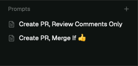

# herdr-prompts

A native sidebar panel mod for **Herdr** (`herdr-app`) to save, manage, and paste recurring prompts directly into your active console or coding agent pane.



## Features
- **Click to Paste:** Clicking any saved prompt focuses the active terminal pane and pastes the prompt text directly into it without pressing Enter.
- **Drag to Reorder:** Drag any prompt row up or down to reorder your list (a highlighted line shows where it will land, and the new order persists automatically).
- **Hover Actions:** Hovering a prompt shows its full text in a tooltip and reveals quick buttons to:
  - **Send (`↵`):** Paste and submit immediately via `hc send`.
  - **Edit:** Open the native prompt editor dialog (also available via right-click).
  - **Delete (`×`):** Remove a saved prompt.
- **Full Add/Edit Dialog (`+`):** Native Herdr modal with a title input and multi-line prompt textarea (`⌘↵` to save, `Esc` to cancel).
- **Persistent State:** Saved prompts are stored atomically in Herdr's native `shared("prompts.items")` state (`~/.config/herdr-app/shared.json`).
- **Compact Rail Support:** Collapses cleanly into icon buttons when the left sidebar is narrowed below `160px`.

## Installation

### Ask your agent in Herdr
Tell any coding agent running inside Herdr:
> Install the `herdr-prompts` mod from `https://github.com/EMRahman/herdr-prompts` and tile it into my left sidebar.

### Manual install
1. Copy `mods/prompts/` into `~/.config/herdr-app/mods/prompts/` and verify it:
   ```bash
   ./install.sh
   ```

2. Add the `prompts` block inside your layout's `sidebar-lists` column (e.g., `~/.config/herdr-app/layouts/main-context.json`) so it tiles alongside **Spaces**, **Agents**, and **Context**:
   ```json
   {
     "id": "prompts",
     "type": "block",
     "content": {
       "mod": "prompts"
     },
     "size": {
       "px": 132
     },
     "min": 41
   }
   ```
