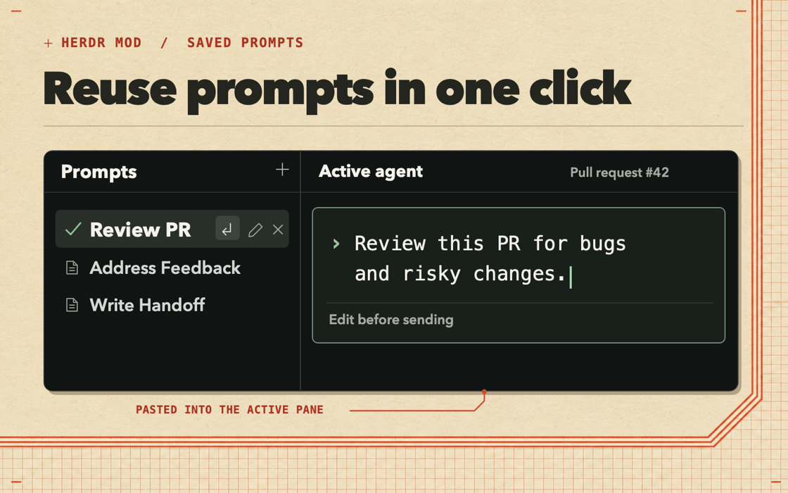

# Saved Prompts for Herdr

Save your recurring prompts in the **Herdr** sidebar. One click puts a prompt in the active console or coding agent so you can review or edit it before sending.



## Why keep some prompts manual?

Keep standing project guidance in `AGENTS.md` and save workflows that need a per-task decision in Prompts. For example, I choose **Create PR, Review Comments Only** when I want the agent to handle review feedback and leave the merge to me. I choose **Create PR, Merge If 👍** when I want it to merge after a thumbs-up. A click pastes the selected prompt into the active pane so I can review or edit it before sending.

## Features
- **Click to Paste:** Clicking any saved prompt focuses the active terminal pane and pastes the prompt text directly into it without pressing Enter.
- **Drag to Reorder:** Drag any prompt row up or down to reorder your list (a highlighted line shows where it will land, and the new order persists automatically).
- **Hover Actions:** Hovering a prompt shows its full text in a tooltip and reveals quick buttons to:
  - **Send (`↵`):** Paste and submit via `hc send`. The button stays visible and disabled while delivery is pending, including when Herdr is waiting for an unfinished draft.
  - **Edit:** Open the native prompt editor dialog (also available via right-click).
  - **Delete (`×`):** Remove a saved prompt.
- **Full Add/Edit Dialog (`+`):** Native Herdr modal with a title input and multi-line prompt textarea (`⌘↵` to save, `Esc` to cancel).
- **Persistent State:** Saved prompts are stored atomically in Herdr's native `shared("prompts.items")` state (`~/.config/herdr-app/shared.json`).
- **Compact Rail Support:** Collapses cleanly into icon buttons when the left sidebar is narrowed below `160px`.

## Installation

### Ask your agent in Herdr
Tell any coding agent running inside Herdr:
> Install the `herdr-prompts` mod from `https://github.com/EMRahman/herdr-prompts/tree/main/herdr-app` and tile it into my left sidebar.

### Manual install
1. Copy `herdr-app/mods/prompts/` into `~/.config/herdr-app/mods/prompts/` and verify it:
   ```bash
   ./herdr-app/install.sh
   ```

2. In your personal layout (for example, `~/.config/herdr-app/layouts/main-context.json`), replace the `sidebar-lists` entry with a `sidebar-panels` column. Add its two children in the order shown below.

   - Your existing `sidebar-lists` column with its other children and a flexible size. Omit `size` or use `"size": { "weight": 1 }`. If Prompts already appears inside this column, move that block to the next position below.
   - The Prompts block.

   ```json
   {
     "id": "prompts",
     "type": "block",
     "content": { "mod": "prompts" },
     "size": { "px": 132 },
     "min": 41
   }
   ```

   Drag the divider just above **Prompts** to resize it. Herdr assigns a divider between two fixed-height blocks to the upper block, so grouping the preceding lists into a flexible column gives Prompts its own divider.

## Development

The list logic (reordering, saving, removing) lives in `herdr-app/mods/prompts/list.js`, separate from the GPUI view in `main.js`, so it can be tested without Herdr:

```bash
bun test
```

CI runs the same tests on every push and pull request.
